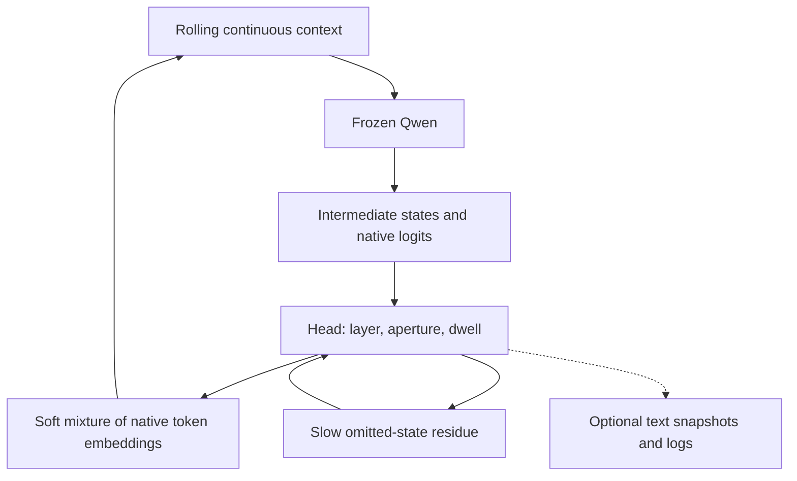

# Ajatuspää — the inward head

A small homeostatic reader exploring the activity of a frozen language model. A continuation of GeometricNeuron, Sihti, NumberHell, Maatuska, Theory and Luotain. Started 25 November 2026.

**Status: experiment implementation, not a demonstrated result.** No real Qwen run has yet been performed.

The question is not whether a model can talk to itself. It is whether its own evolving continuous activity can regulate where and at what resolution it reads itself next.



The projection is **read-only**. We do not overwrite the residual stream with a PCA vector. The feedback carrier is a bounded-norm mixture of genuine input embeddings. A new frozen forward is executed every tick, not a walk over cached word vectors. The shortlist is anchored to native logits; the model is not a passive dictionary.

## Run on Windows / RTX 3060

Use the same Python/PyTorch CUDA environment that already runs Qwen3 in Theory. Transformers must support Qwen3 (4.51 or later; the existing 4.56.x environment is suitable in principle). Do not reinstall your CUDA PyTorch build unnecessarily.

```bat
git clone https://github.com/anttiluode/Ajatuspaa.git
cd Ajatuspaa
python3.13 ajatuspaa.py --self-test
python3.13 ajatuspaa.py --device cuda --steps 16 --trials 1 --seeds oak winter --out runs/pilot --verbose
```

The self-test instantiates a randomly initialized tiny Qwen3 locally (no checkpoint download). It tests the nine arms, finite dynamics, parameter immutability and the paired reset control. It is not scientific evidence. The pilot loads the actual model; default FP16 on CUDA, FP32 on CPU. If FP16 is nonfinite, use `--dtype bfloat16` (if supported) or `--dtype float32` and record the change before the full run. FP32 needs more VRAM.

Full matrix, once the pilot works:

```bat
python3.13 ajatuspaa.py --device cuda --out runs/experiment001
```

Optional single live trace:

```bat
python3.13 ajatuspaa.py --device cuda --steps 64 --trials 1 --seeds cabbage --arms residue --out runs/cabbage --verbose
```

Use a fresh output directory for each run. Existing output files in the selected directory are replaced. No checkpoints are modified or written.

## Files

- [EXPERIMENT001.md](EXPERIMENT001.md): fixed protocol, hypotheses, controls and failure criteria.
- [ajatuspaa.py](ajatuspaa.py): real model loop, nine arms, tiny-model plumbing test, JSON logging.
- [view.html](view.html): offline trace viewer. Open in a browser and load traces.jsonl from a run.
- Output: config.json (model revision/settings), traces.jsonl (one run per line with all ticks), summary.json (concept-level statistics and paired intervention diagnostics). Partial traces survive a failure.

## What to look for

A good looking string of words is not evidence of thought. Compare recurrence, diversity, seed dependence, carrier effective token count, actual address/aperture changes, and reset/shuffled memory ablations. The pilot cannot pass the full experiment gate. The full matrix is 8 concepts × 3 trial IDs × 9 arms × 64 ticks = 13,824 experimental forwards, plus a shared calibration pass; no training or growing context.

The seed is placed in the initial rolling context (repeated/truncated to eight tokens). It is not permanently clamped. Deterministic arms deliberately repeat across trial IDs, so same-seed reproducibility is not independent evidence: interpret specificity alongside the other-seed similarity. The initial protocol's semantic interpretation is a hypothesis, not a proven property of PCA. Intermediate logit lenses are uncalibrated; convex embedding mixtures may be out of distribution. This head is an external controller over internal observations, not a new trained transformer block.

If the head cannot beat fixed and exogenous controls, keep the negative result. If it can, the next step is independent semantic evaluation, not a consciousness claim.

License: see LICENSE.
